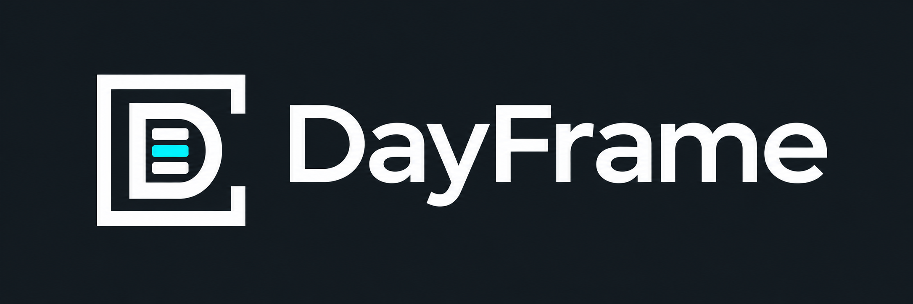

# DayFrame

A private desktop dashboard for planning your day, organizing project tickets and tracking time. **Python + PySide6 / Qt Widgets**, with SQLite and optional private LAN synchronization. Windows and Linux source; no embedded browser.

Version **0.5.0**, formerly TimeManager. Existing profiles and sync credentials keep working; see [branding and compatibility](docs/BRANDING.md).

## What works

- Today: priorities, due/overdue work, agenda, three major-event countdowns and the active timer.
- Projects: shared Kanban, nested Map, List, Details, ticket inspector, checklists and dependencies.
- Calendar: marked Month, Upcoming events and Sunday-first weekly timeline; clickable event editing and work blocks.
- Map: inherited classification, parent/child tickets, section sequence links, hover ghosts, confirmation, Undo and Unsorted tray.
- Time: persistent ticket/unassigned timer, manual entries and overlap review.
- Rich Quick Add, colored preset/custom labels, private accounts and remembered login until Logout.
- Graphite/Cyan, Terminal/Amber, Paper/Linen, Midnight/Studio and System, with separate density and text scale.
- SQLite backup/import, transactional sync outbox, private LAN hub, certificate pinning, field merges and conflict review.

See [current status](docs/CURRENT_STATUS.md) for verification and limitations. Reminders, richer recurrence, Code/GitHub overview, Team and mobile remain future work.

## Windows

For a source checkout, install Python 3.12+ (3.14 recommended) and run:

```powershell
powershell -ExecutionPolicy Bypass -File scripts/setup-windows.ps1
.venv\Scripts\python.exe app.py
```

Or open **Start DayFrame.cmd** after setup. The launcher also recognizes a locally built portable bundle. Standalone builds do not require a separate Python installation; keep the entire DayFrame folder with its _internal directory.

On the original development machine the checkout remains at C:\Apps\TimeManager; the folder name does not control the app's identity.

## Linux Mint

Use a user-owned checkout and a fresh Linux environment:

```sh
sh scripts/setup-linux.sh
sh start-dayframe.sh
```

Python 3.12+ (3.14 recommended) and system Qt/X11 libraries are required. See [operations](docs/OPERATIONS.md) for Mint dependencies, hub setup, pairing and packaging. Linux CI targets Ubuntu; the owner's exact Mint installation still needs a live check.

## Accounts and data

Create a private account or connect an unconfigured installation to your existing LAN account. Simple passwords are accepted. Sign-in persists locally until Options → Log out. Example projects load only when explicitly requested.

The established runtime paths remain **%LOCALAPPDATA%\TimeManager** on Windows and **$XDG_DATA_HOME/TimeManager** on Linux (default ~/.local/share/TimeManager). The database remains timemanager.db. Runtime data stays outside the checkout. Do not share a live SQLite file between devices; use the optional hub.

For an earlier Electron installation, import a consistent database backup into an unconfigured native profile. The original stays intact. See [migration](docs/NATIVE_MIGRATION.md).

## Development

```powershell
.venv\Scripts\python.exe -m pip install -r requirements-dev.txt
.venv\Scripts\python.exe -m unittest discover -s tests -v
.venv\Scripts\python.exe -m PyInstaller DayFrame.spec --noconfirm
```

Use .venv/bin/python on Linux. Build on each target OS. [CONTRIBUTING.md](CONTRIBUTING.md) covers branches, checks, isolated profiles and releases. GitHub Actions runs Windows/Linux tests, packaging and packaged smoke checks.

## Project guide

| Path | Contents |
|---|---|
| [SPEC.md](SPEC.md) | Full accepted product requirements |
| [docs/DECISIONS.md](docs/DECISIONS.md) | Owner decisions and architecture changes |
| [docs/DESIGN_SYSTEM.md](docs/DESIGN_SYSTEM.md) | Layout, typography and theme principles |
| [docs/ARCHITECTURE.md](docs/ARCHITECTURE.md) | Native UI, persistence and sync boundaries |
| [docs/DATA_MODEL.md](docs/DATA_MODEL.md) | Data concepts and schema |
| [docs/CALENDAR_AND_MAP.md](docs/CALENDAR_AND_MAP.md) | Calendar and guarded map interactions |
| [docs/QUICK_ADD_AND_LABELS.md](docs/QUICK_ADD_AND_LABELS.md) | Capture, labels and frame styling |
| [docs/ACCOUNTS_AND_SYNC.md](docs/ACCOUNTS_AND_SYNC.md) | Account/sync and recovery design |
| [docs/OPERATIONS.md](docs/OPERATIONS.md) | Run, build, backup and LAN hub instructions |
| [docs/CURRENT_STATUS.md](docs/CURRENT_STATUS.md) | Delivered scope and known gaps |
| [docs/BRANDING.md](docs/BRANDING.md) | Logo/icon source, prompts and rename compatibility |
| [CHANGELOG.md](CHANGELOG.md) | Version history |
| dayframe/ | Application, domain, store and hub |
| tests/ | Database, sync/TLS and native UI tests |
| assets/ | Logo, generated icon master, PNG and ICO exports |
| docs/concepts/ | Original concept references, predating the name change |

Generated installers, databases, credentials, virtual environments, build folders and historical local source archives are excluded from Git. Third-party components retain their notices; see [THIRD_PARTY.md](docs/THIRD_PARTY.md). No open-source license has been selected for this private project.
