<p align="center">
  
</p>

<p align="center">
  <strong>A private desktop planner for your day, your projects and your time.</strong><br>
  Today dashboard · Kanban and Map boards · Calendar · Tickets · Git-aware Code page · Time tracking
</p>

<p align="center">
  
  
  
  
</p>

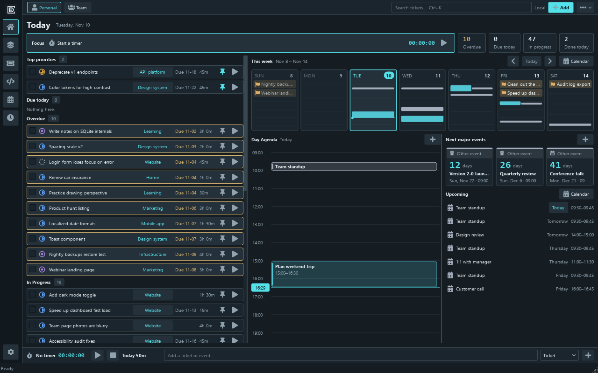

DayFrame keeps one set of records behind every view. A ticket you capture with Quick Add is the same ticket on the Kanban board, on the Map, in the Tickets table, on the calendar and under the timer. Your data lives in a local SQLite database on your own machine, with no cloud account. The only network features are the optional sync hub and the optional GitHub connection. If you use more than one computer, an optional private hub on your own network can keep them in sync.

It is written in Python with PySide6 (Qt Widgets) and runs on Windows and Linux.

> **Status:** version 0.7.0, a private project in active development. There is no public installer or GitHub Release yet; you run DayFrame from source, or build a portable bundle yourself. See [Download and install](#download-and-install).

## Contents

- [Features](#features)
- [Screenshots](#screenshots)
- [Download and install](#download-and-install)
- [First run](#first-run)
- [Your data](#your-data)
- [Sync between devices](#sync-between-devices)
- [Development](#development)
- [Project layout](#project-layout)
- [Documentation](#documentation)
- [License and third-party notices](#license-and-third-party-notices)

## Features

**Home**
- A focus timer beside four figures (overdue, due today, in progress, done today) that open the matching ticket list.
- Top priorities, due and overdue work as compact rows with a symbol for each stage.
- A week strip of seven clickable day cards, a Day Agenda that follows the selected day, countdown tiles for major events and an upcoming list with a symbol per event type.
- The layout adapts: three columns when wide, two with tabs at medium widths, and tabs on narrow windows.

**Projects: Kanban, Map and Details**
- Kanban lanes for Not Started, In Progress, Processed, Review and Complete, each stage with its own symbol and color. Dragging shows a destination ghost and can be undone.
- A nested **Map** of sections and tickets with parent/child links, dependencies and sequence links. Links leave and enter cards at right angles and route around unrelated cards. Classifying, linking or nesting needs a 1.5 second hold with a ghost preview and a release confirmation, so nothing moves by accident. Manual placement and Undo are preserved, and cycles and cross-project links are rejected.
- A Details table and a compact ticket inspector with Edit, Track, Schedule, Code and a status menu.

**Tickets**
- An overview page with stat tiles and charts: completions per day, tracked time per day, created against completed per week, open work by stage and by project, and estimate against tracked time.
- A sortable, filterable table of every ticket, with quick views such as All open, Overdue, Blocked and Due this week.
- A forum-style ticket page with a Markdown description, comments, pasted or attached screenshots, activity, relations, scheduled work and in-place editing.

**Code**
- Connect one Git repository per project, with a checkout folder per device.
- Each ticket keeps *changesets*: saved working-tree changes whose diff is stored (and synced), so you can shelve work on one ticket and switch to another.
- Fetch, fast-forward pull, commit, push and branch create/switch run in the background, with confirmations that show the command. Push never forces.
- Working tree (stage, unstage, discard), History (commit graph with merges, branches and tags), Branches (tracking, ahead/behind, stashes) and a change browser with a file tree and numbered unified or split diffs.
- Optional GitHub connection by access token (stored in the OS credential store) for checks, releases, pull requests and issues.

**Calendar and time**
- A marked Month view, an Upcoming list and a Sunday-first weekly timeline. Click to edit, drag timed cards to move them and drag the bottom edge to resize in 15-minute steps, with Undo.
- Events, birthdays, multi-day events and work blocks, kept connected to tickets and the timer. Deadlines stay separate.
- A persistent ticket or unassigned timer, manual entries and overlap review.
- A searchable time zone picker with UTC offsets and current times, plus up to three world clocks in the bottom bar.

**Capture and labels**
- Rich Quick Add in the bottom bar creates tickets or events in one atomic step.
- Colored label chips with presets and custom names. Press Enter to add a label without saving the ticket.

**Appearance**
- Themes: Graphite, Terminal, Paper, Midnight, Nord, Catppuccin, Editor (Dracula, Tokyo Night, One Dark, Monokai, Gruvbox, Solarized, Rosé Pine, Everforest) and System.
- Every theme has its own color schemes and a Custom scheme with a color wheel and per-element colors. Fonts, corner style, density, text size and heading size are set independently.

**Privacy and reliability**
- Private local accounts. Simple passwords are accepted, and sign-in is remembered on the device until you choose Log out.
- Every write is a single SQLite transaction together with its sync record. Consistent backups, import that never overwrites the source, and a confirmed **Clear workspace** that backs up first.

## Screenshots

All images show the bundled demo workspace (fictional projects and tickets) at the default 1280×800 window size.

### Projects

| Kanban | Map |
|---|---|
| 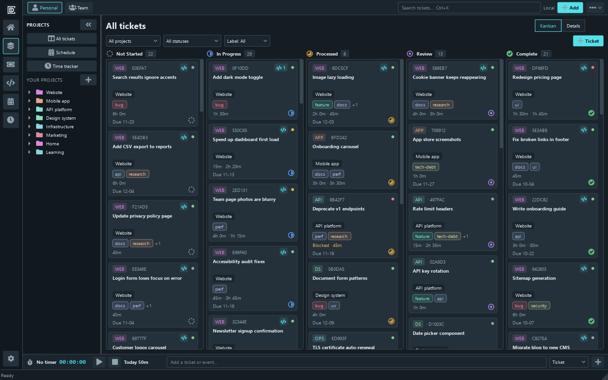 | 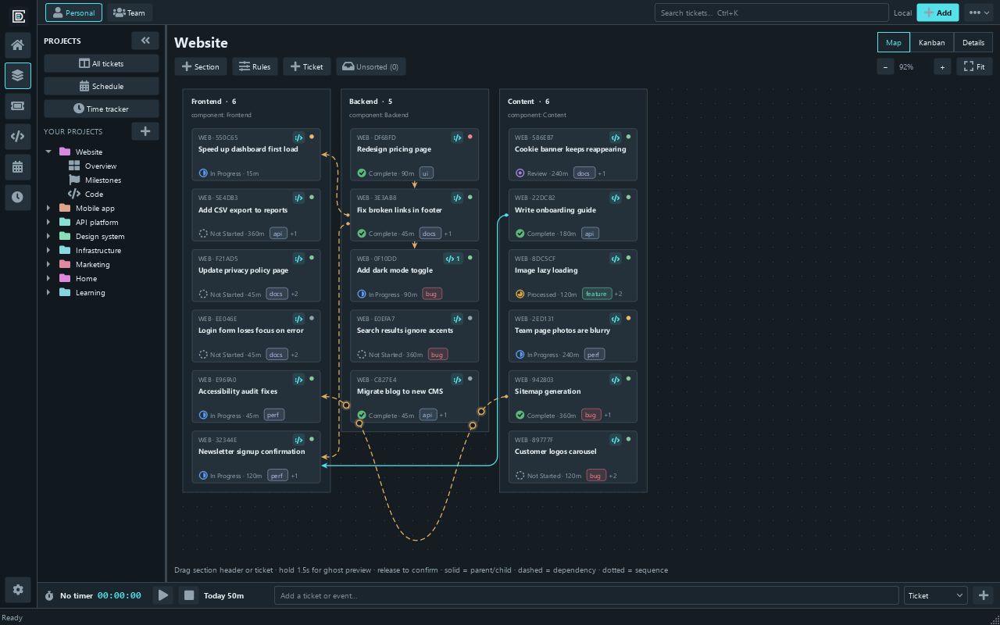 |

### Tickets and Code

| Tickets overview | Ticket page |
|---|---|
| 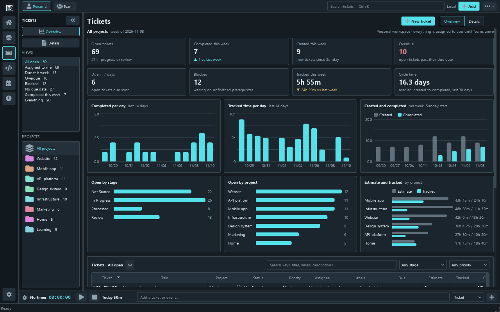 | 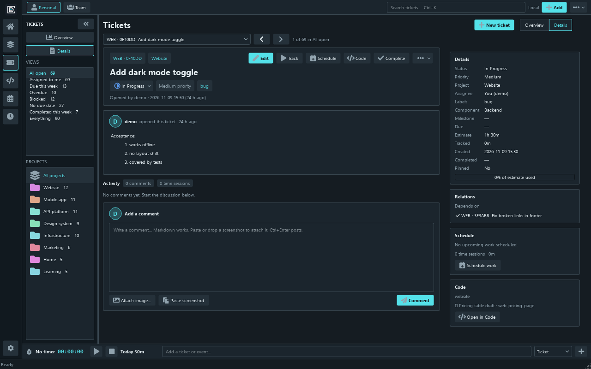 |

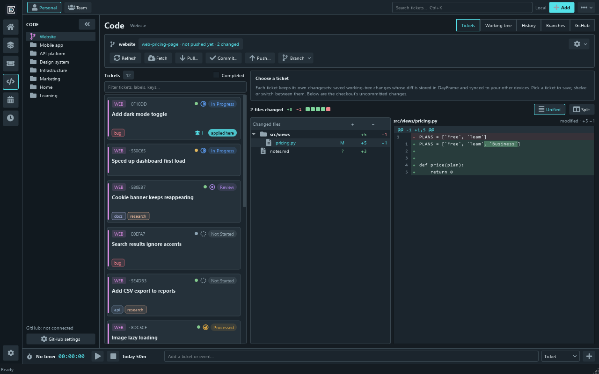

### Calendar and Settings

| Calendar | Settings |
|---|---|
| 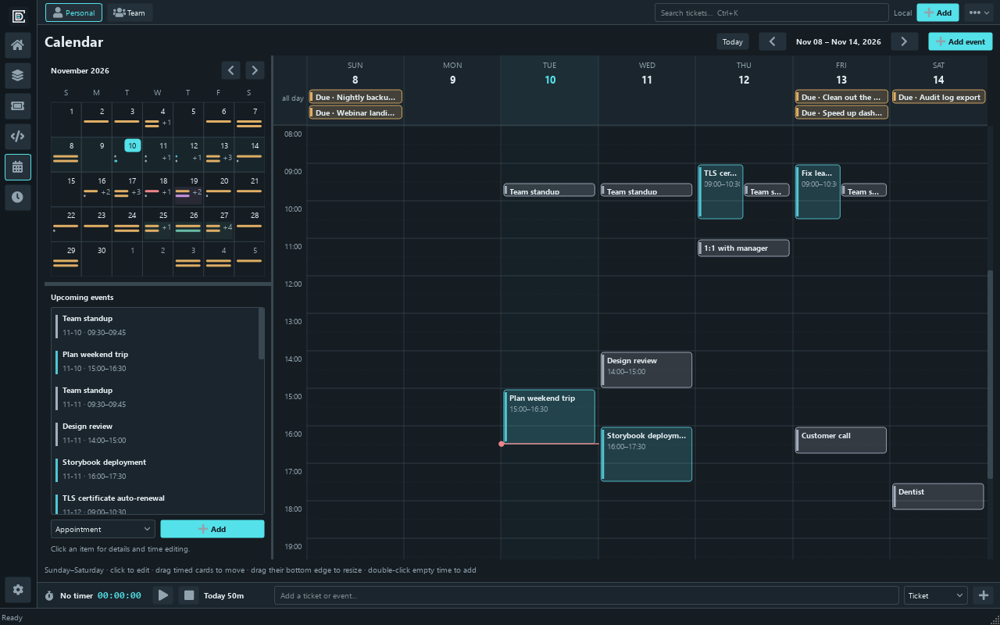 | 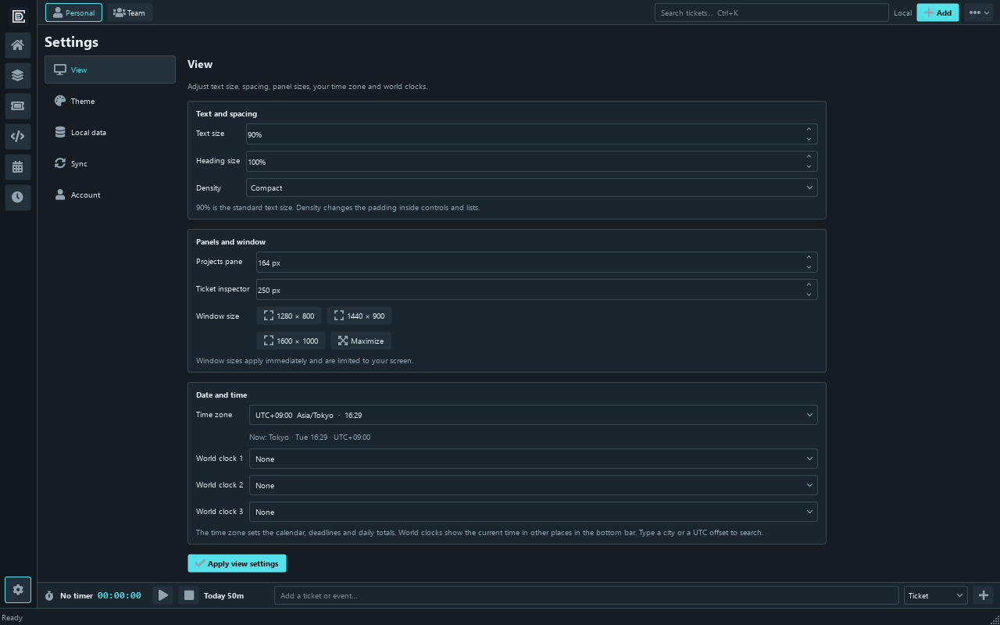 |

### Themes

| Nord | Terminal (Amber) |
|---|---|
| 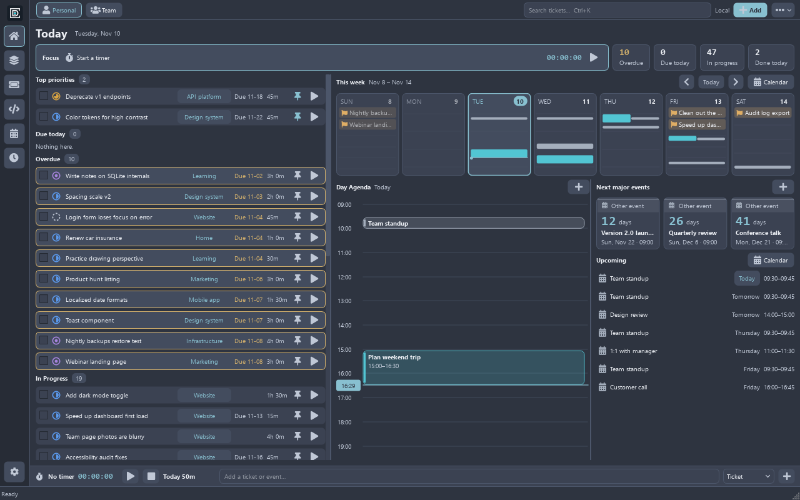 | 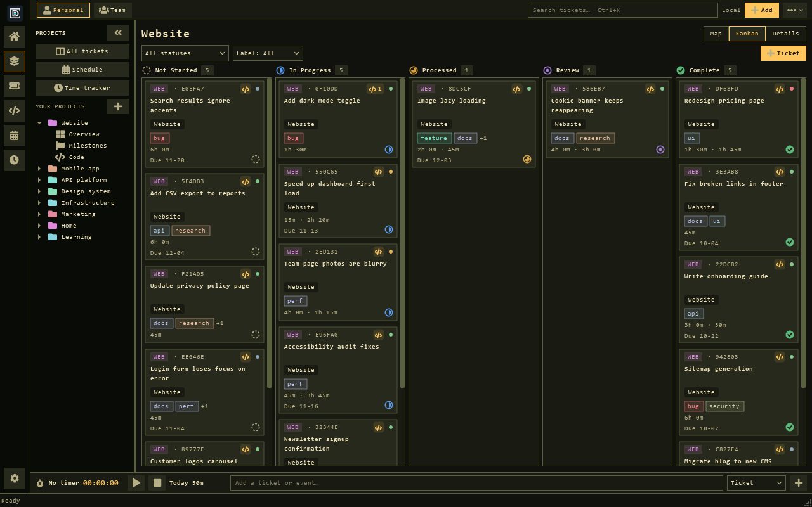 |

| Paper | Catppuccin |
|---|---|
| 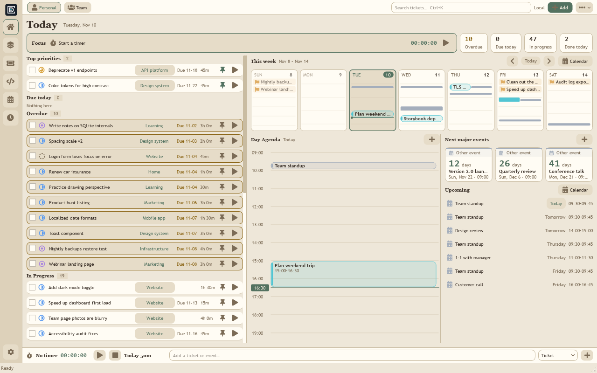 | 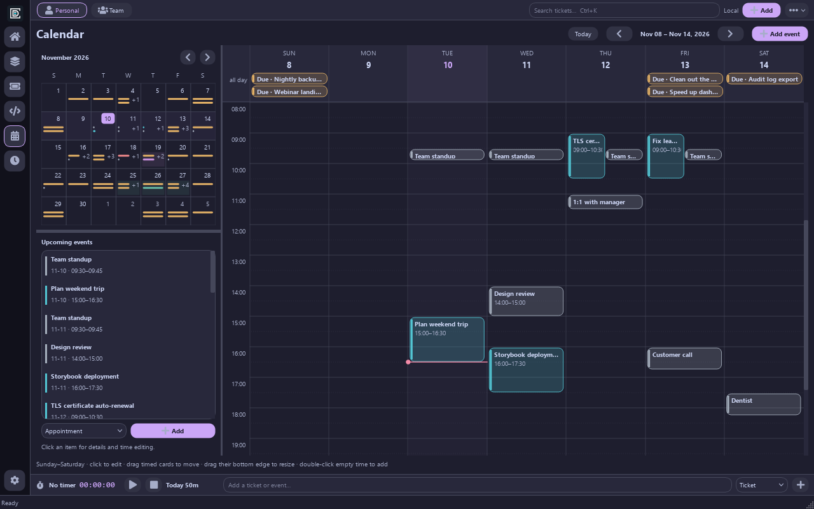 |

More reference screenshots are in [docs/screenshots/current/](docs/screenshots/current/).

## Download and install

DayFrame is not published as an installer or GitHub Release. Get the source from GitHub and run it with Python; you can also build your own standalone bundle.

### Get the source

The repository is private, so you need access to it.

```sh
git clone https://github.com/TylerFreemont0712/DayFrame.git
cd DayFrame
```

Or use **Code → Download ZIP** on the repository page and extract it to a folder you own.

### Requirements

| | |
|---|---|
| Python | 3.12, 3.13 or 3.14 (3.14 recommended) |
| Git | Optional, but the Code page needs it on your `PATH` |
| Windows | Developed and tested on Windows 11 |
| Linux | A desktop session with the Qt xcb libraries. On Ubuntu-based distributions such as Linux Mint: `sudo apt install python3-venv libegl1 libxcb-cursor0 libxkbcommon-x11-0` |

Runtime dependencies are pinned in [requirements.txt](requirements.txt): PySide6-Essentials, QtAwesome, keyring, cryptography and tzdata.

### Windows

From the project folder, in PowerShell:

```powershell
powershell -ExecutionPolicy Bypass -File scripts/setup-windows.ps1
.venv\Scripts\python.exe app.py
```

The setup script finds a supported Python, creates `.venv` and installs the dependencies. After that you can double-click **Start DayFrame.cmd** to launch the app. It opens a packaged build if one is present, and otherwise runs from the source environment.

### Linux

```sh
sh scripts/setup-linux.sh
sh start-dayframe.sh
```

CI exercises Ubuntu, but the author's own Linux Mint installation has not been verified yet, so expect to report rough edges. See [operations](docs/operations/OPERATIONS.md) for dependencies and a desktop launcher template.

### Try it with demo data first

To look around without touching a real profile, create a throwaway profile filled with sample projects, tickets, time and a small Git repository:

```powershell
.venv\Scripts\python.exe scripts/seed-demo.py build/demo-profile
.venv\Scripts\python.exe app.py --data-dir build/demo-profile
```

On Windows, `Preview DayFrame.cmd -Demo` does the same in a separate demo profile. The demo account is signed in automatically. On Linux, use `sh scripts/preview.sh --demo`.

### Build a standalone bundle (optional)

A portable folder that runs without a separate Python installation can be built with PyInstaller on the target OS:

```powershell
.venv\Scripts\python.exe -m pip install -r requirements-dev.txt
.venv\Scripts\python.exe -m PyInstaller DayFrame.spec --noconfirm
```

The result is `dist/DayFrame/`. Keep the whole folder, including `_internal`. On Linux use `.venv/bin/python` and the same command. A Windows installer can also be built with NSIS; see [CONTRIBUTING.md](CONTRIBUTING.md#version-and-release) and [the release policy](docs/operations/RELEASES.md).

## First run

1. On first launch, **create a private account** (a username and password that stay on this machine), or connect to an existing account on your own hub, or import an existing DayFrame database.
2. DayFrame opens on **Today**. Use **Add** in the top bar or the Quick Add bar at the bottom to create a ticket or an event.
3. Create a project under **Projects** to get Kanban, Map and Details views for it. Example projects load only if you ask for them.
4. Press **Ctrl+K** to search tickets. Start the timer from any ticket's play button.
5. Open **Settings** (the cog at the bottom of the rail) to choose a theme, text size, density, time zone and world clocks.

The navigation rail on the left switches between Today, Projects, Tickets, Code, Calendar and Time.

## Your data

DayFrame keeps everything in a SQLite database named `timemanager.db` inside your profile folder. The name predates the DayFrame rename and is kept so existing profiles keep working.

| OS | Default profile folder |
|---|---|
| Windows | `%LOCALAPPDATA%\TimeManager` |
| Linux | `$XDG_DATA_HOME/TimeManager` (default `~/.local/share/TimeManager`) |

- Runtime data is kept outside the source folder. Use `--data-dir PATH` to run against a separate profile, and never point tests or experiments at your real one.
- Only one DayFrame process opens a profile at a time.
- **Settings → Local data → Back up database** writes a consistent snapshot. Backups contain a password verifier and personal data, so keep them somewhere protected.
- Importing a backup copies it and leaves the original untouched; it never overwrites an already configured account.
- Do not put the live database on a shared drive or sync it with a file-sync service. Use the hub below.

See [backup and recovery](docs/operations/OPERATIONS.md#backups-and-recovery) for restore steps.

## Sync between devices

Sync is optional and private. A small headless Python hub (no Qt required) runs on a machine you control and keeps your devices in step over your local network:

- TLS is required for anything other than loopback, with the hub's certificate fingerprint pinned in each client.
- Changes travel through a transactional outbox. Field-level merges are automatic, and real conflicts are listed in Settings so you can keep your version or take the hub's.
- Passwords and tokens are never stored in source or in the database; device credentials use the OS credential store.

Setup, certificates, pairing steps and a systemd service template are in [docs/operations/OPERATIONS.md](docs/operations/OPERATIONS.md). Update the hub before syncing from a client that uses the Code page (schema 5 and later).

## Development

```powershell
.venv\Scripts\python.exe -m pip install -r requirements-dev.txt
.venv\Scripts\python.exe -m unittest discover -s tests -v
.venv\Scripts\python.exe -m ruff format dayframe tests
.venv\Scripts\python.exe -m ruff check dayframe tests
```

Use `.venv/bin/python` on Linux and set `QT_QPA_PLATFORM=offscreen` when running UI tests without a display. The full suite takes several minutes. Tests build their own profiles under `build/test-data/`.

Run the app from source in a separate profile with `.venv\Scripts\python.exe app.py --data-dir build/dev-profile`, or use **Preview DayFrame.cmd**. [CONTRIBUTING.md](CONTRIBUTING.md) covers branches, checks and pull requests. GitHub Actions runs Windows and Ubuntu source tests; packaging is opt-in.

## Project layout

```
dayframe/core/   domain rules, calendar projections, palettes   (no Qt, no SQLite)
dayframe/data/   Store, schema, migrations, outbox              (no Qt)
dayframe/sync/   sync client and private hub                    (no Qt)
dayframe/code/   Git integration and the GitHub client
dayframe/ui/     main window (one module per page), views, dialogs, theme
tests/           database, sync/TLS and native UI tests
scripts/         setup, preview, demo-data, packaging helpers
assets/          logo, icon master, PNG and ICO exports
```

Imports point downward only (`ui → sync → data → core`), and every write goes through `Store.command(...)`. The [code map](docs/engineering/CODE_MAP.md) describes each module.

## Documentation

| Document | Contents |
|---|---|
| [SPEC.md](SPEC.md) | Accepted product requirements |
| [CHANGELOG.md](CHANGELOG.md) | Version history and unreleased notes |
| [docs/status/CURRENT_STATUS.md](docs/status/CURRENT_STATUS.md) | What is delivered, tested and still missing |
| [docs/status/IDEAS.md](docs/status/IDEAS.md) | Ideas for future work |
| [docs/product/](docs/product/) | Owner decisions, design system, calendar and map rules, Quick Add and labels |
| [docs/engineering/](docs/engineering/) | Architecture, code map, data model, accounts and sync |
| [docs/operations/](docs/operations/) | Running, hub setup, releases, branding identifiers, third-party notices |
| [CONTRIBUTING.md](CONTRIBUTING.md), [AGENTS.md](AGENTS.md), [CLAUDE.md](CLAUDE.md) | Workflow and project rules |

Reminders, richer recurrence, Team features and a mobile companion are future work; see the current status document for known limitations.

## License and third-party notices

No open-source license has been selected for this private project, so all rights are reserved. Third-party components keep their own notices; see [THIRD_PARTY.md](docs/operations/THIRD_PARTY.md).
